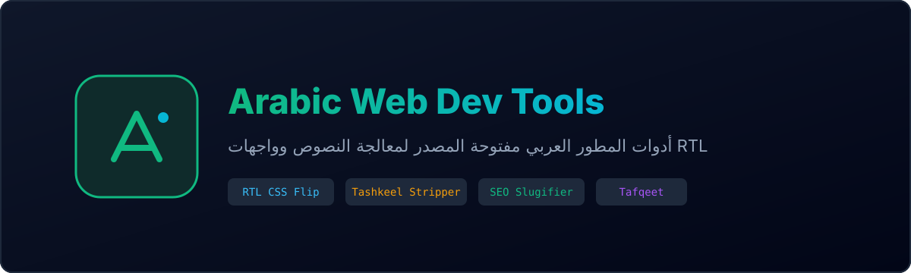

<p align="center">
  
</p>

# Arabic Web Dev Tools 🛠️ (أدوات المطور العربي)

<p align="center">
  <a href="https://opensource.org/licenses/MIT"></a>
  
  
  
  
  <a href="https://seotarek.github.io/arabic-web-dev-tools/"></a>
</p>

حزمة أدوات ويب قياسية مفتوحة المصدر بدون أي اعتمادات خارجية نهائياً (**Zero-Dependency**)، مصممة ومبنية لمعالجة كافة التحديات البرمجية والهندسية الخاصة باللغة العربية، وتطوير الواجهات ثنائية الاتجاه (**BiDi / RTL**)، ومطابقة معايير السيو الحديثة، وخصائص **W3C CSS Logical Properties**.

🌐 **[المعاينة الحية والمختبر الهندسي التفاعلي (Live Portal)](https://seotarek.github.io/arabic-web-dev-tools/)**

---

## ⚡ الأدوات والميزات الرئيسية (Features)

| الأداة | الوصف الهندسي | المثال البرمجي |
| :--- | :--- | :--- |
| **Arabic SEO Slug** | توليد روابط URLs نظيفة لمحركات البحث مع معالجة التشكيل وحذف الكلمات الشائعة | `دليل السيو 2026!` ➔ `دليل-السيو-2026` |
| **Smart Meta Truncator** | قص نصوص الميتا والعناوين بذكاء عند حدود الكلمات دون كسر أواخر الكلمات | `دليل مفصل لبناء...` |
| **W3C CSS Logical Properties** | تحويل الخصائص الفيزيائية (Left/Right) إلى خصائص منطقية حديثة تدعم اللغتين تلقائياً | `margin-left` ➔ `margin-inline-start` |
| **BiDi Trailing Fixer & Isolator** | عزل النصوص ثنائية الاتجاه ومنع قفز علامات الترقيم في نهاية الجمل العربية | `زوروا https://site.com!` ➔ يمنع انعكاس `!` |
| **Eastern Numerals & Currency** | تحويل وتنسيق الأرقام المشرقية (٠-٩) والعملات العربية الرسمية | `1250` ➔ `١٢٥٠` أو `1,250.00 ر.س` |
| **Tashkeel & Quranic Stripper** | إزالة التشكيل وعلامات التنوين والمصحف الشريف والكشيدة | `مَرْحَبًا` ➔ `مرحبا` |
| **Arabic Normalizer** | توحيد الألفات والهمزات والتاء المربوطة وحروف الفارسية/الأردية | `إبراهيم، مدرسة` ➔ `ابراهيم، مدرسه` |
| **Keyboard Typo Fixer** | استعادة الكلمات المكتوبة بالخطأ بحروف إنجليزية (يدعم الـ Shift والـ Ligatures) | `lvpfh` ➔ `مرحبا` / `Hihl` ➔ `أهلا` |

---

## 📦 التثبيت البرمجي (Installation)

### عبر NPM

```bash
npm install arabic-web-dev-tools
```

### عبر Yarn / PNPM

```bash
pnpm add arabic-web-dev-tools
# أو
yarn add arabic-web-dev-tools
```

### عبر المتصفح مباشرة (ESM CDN)

```html
<script type="module">
  import { generateArabicSlug, fixKeyboardTypo } from 'https://esm.sh/arabic-web-dev-tools';
  console.log(generateArabicSlug("أفضل أدوات الويب لعام 2026!"));
</script>
```

---

## 💻 أمثلة الاستخدام البرمجية (Usage Examples)

```javascript
import {
  generateArabicSlug,
  truncateArabicMeta,
  convertToLogicalCss,
  convertToRtlCss,
  convertTailwindToLogical,
  toEasternDigits,
  toWesternDigits,
  formatArabicCurrency,
  stripTashkeel,
  normalizeArabic,
  removeTatweel,
  fixKeyboardTypo,
  sanitizeMixedText,
  wrapBiDi
} from 'arabic-web-dev-tools';

// 1. توليد رابط سيو نظيف
console.log(generateArabicSlug("أفضل 10 ممارسات في هندسة البرمجيات لعام 2026!"));
// => "أفضل-10-ممارسات-في-هندسة-البرمجيات-لعام-2026"

// مع حذف حروف الجر وتوحيد الهمزات
console.log(generateArabicSlug("كيف تبدأ في تعلم البرمجة من الصفر", { removeStopWords: true, normalize: true }));
// => "تبدا-تعلم-البرمجه-الصفر"

// 2. قص نصوص الوصف في جوجل عند حدود الكلمات
console.log(truncateArabicMeta("دليل مفصل يشرح أفضل الممارسات الهندسية لبناء تطبيقات سريعة", 35));
// => "دليل مفصل يشرح أفضل الممارسات..."

// 3. تحويل CSS إلى الخصائص المنطقية الحديثة (W3C CSS Logical Properties)
console.log(convertToLogicalCss(".card { margin-left: 15px; padding-right: 10px; float: left; }"));
// => ".card { margin-inline-start: 15px; padding-inline-end: 10px; float: left; }"

// 4. تحويل كلاسات Tailwind إلى الكلاسات المنطقية
console.log(convertTailwindToLogical("mr-4 pl-2 left-0 text-left"));
// => "me-4 ps-2 start-0 text-start"

// 5. تحويل الأرقام وتنسيق العملات
console.log(toEasternDigits("2026-05-14"));
// => "٢٠٢٦-٠٥-١٤"

console.log(formatArabicCurrency(1500, "SAR"));
// => "1,500.00 ر.س"

console.log(formatArabicCurrency(1500, "EGP", { useEasternDigits: true }));
// => "١٬٥٠٠٫٠٠ ج.م"

// 6. استعادة نصوص لوحة المفاتيح المعكوسة (يدعم Shift والرموز والـ Ligatures)
console.log(fixKeyboardTypo("lvpfh"));
// => "مرحبا"

console.log(fixKeyboardTypo("High"));
// => "أهلا"

console.log(fixKeyboardTypo("أهلا"));
// => "Hib"

// 7. استقرار علامات الترقيم في النصوص ثنائية الاتجاه (BiDi)
console.log(sanitizeMixedText("رابط التوثيق هو https://example.com!"));
// => يمنع قفز علامة التعجب إلى أول السطر
```

---

## 🧪 الاختبارات والجودة (Testing & CI)

المشروع مزود بحزمة اختبارات وحدات قياسية متكاملة تعمل عبر بيئة Node.js المدمجة دون أي مكتبات فحص خارجية:

```bash
npm test
```

---

## 📄 الترخيص (License)

هذا المشروع مرخص تحت رخصة **MIT License** - راجع ملف [LICENSE](LICENSE) للمزيد من التفاصيل.

تم التطوير بكل فخر بواسطة المهندس **[طارق محمد (Tarek Mohamed)](https://tarek-mohamed.me.eg/)**.
